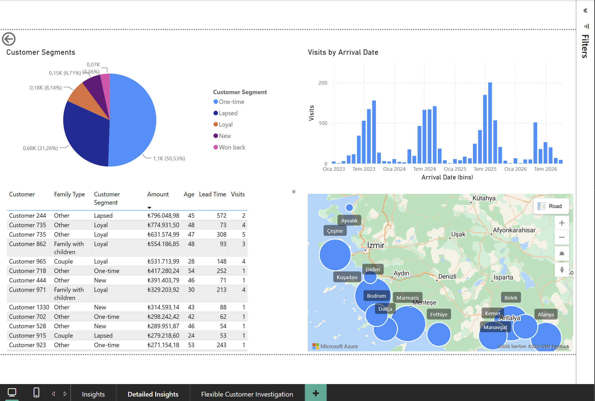

# Travel Agency Customer Segmentation

**Business question:** Who are our loyal customers, when do they book, and which hotels are relevant to the next sales conversation?



*Earlier Power BI export. The current model uses the shorter **Customers** KPI caption; [see the current model notes](docs/dashboard.md#insights).*

I started with the team's difficulty identifying loyal customers. I changed the export routine to recover booking-month information, resolved hotel-name and join-grain problems, and added lifecycle, lead-time and location views. Staff can use past booking patterns to narrow hotel suggestions across two travel-agency branches.

**Operational use:** Prepare the monthly exports, refresh the report manually, and review the customer profile and hotel history before a sales conversation.

**Tools:** Power BI · DAX · Power Query · SQL / SQLite (public companion) · Python · LocationIQ<br>
**Status:** In operational use; manually refreshed; source data remains private.

[Decision workflow and evidence](docs/decision-workflow.md) · [End-to-end BI pipeline](docs/end-to-end-bi-pipeline.md) · [▶ Run the public demo](#run-the-public-demo) · [SQL companion](sql/) · [QA & validation](#qa--validation) · [Full story](docs/story.md)

## Run the public demo

The demo uses **fully synthetic data**, generated locally without private files, credentials, or API requests.

1. Download this repository (Code → Download ZIP) and extract it, or clone it.
2. Install Python 3.10+ and a current [Power BI Desktop for Windows with PBIP/TMDL support](https://learn.microsoft.com/en-us/power-bi/developer/projects/projects-overview).
3. Close the project in Power BI Desktop, then run these commands from the repository folder:

```bash
python -m pip install -r requirements.txt
python scripts/setup_demo.py
```

4. Open `Travel-Agency-Mock.pbip` and select **Refresh**.

The script creates sample workbooks in `demo-data/` and updates the local project's `DemoDataFolder` Power Query parameter. If you move the repository, close Power BI Desktop and rerun the setup command. For another sample-data location, use `python scripts/setup_demo.py --data-dir "path/to/demo-data"`, or edit `DemoDataFolder` under **Transform data → Manage Parameters**.

Python generates the files on Windows, macOS, or Linux; viewing the report requires Power BI Desktop for Windows. No Power BI Service workspace or cloud refresh setup is required. If a map requests an online map service, the remaining report pages can still be reviewed offline.

The sample uses a fixed **2026 reference year**, invented identities, and matching keys across related tables. Its totals differ from the original project's screenshots and operational figures. [View all dashboard pages and segmentation notes](docs/dashboard.md).

## SQL evidence

The [SQL companion README](sql/README.md) explains the runnable Excel → raw → staging → star schema → KPI pipeline. The star layer contains `dim_customer`, `dim_hotel`, `dim_date` and the reservation-grain `fct_booking`; the existing marts retain lifecycle segmentation, hotel-key normalization, window functions and data-quality checks. It uses **48 synthetic reservations, 30 customers, and 6 hotels**; SQL is a public portfolio companion, not a claim about the original production workflow.

After installing the dependencies above, run it from the repository root:

```bash
python sql/run_demo.py
```

[Executed SQL results](sql/RESULTS.md) · [SQL data dictionary](sql/DATA_DICTIONARY.md)

## QA & Validation

[](https://github.com/dogantunagerguz/travel-agency-customer-segmentation/actions/workflows/ci.yml)

**13 SQL data-quality controls · 23 automated tests.** The synthetic fixture reconciles **48 reservations → 48 fact rows**, with **30 customers and 6 hotels**. The original nine controls and four star-schema relationship controls report zero issues; the test suite also checks that the committed SQL results match a fresh run.

| Test group | Tests | Coverage |
|---|---:|---|
| Demo sources and portability | 6 | Workbook/sheet/column references, related keys, relocation, repeatable sample values and preservation of existing files |
| SQL | 6 | Lifecycle distribution, source-to-fact counts, star-schema grain, thirteen quality controls and result-snapshot consistency |
| Money parsing and API-key configuration | 11 | Signed and locale-formatted amounts, Excel output and local configuration using test-only keys |

After installing the dependencies, run the same suite as GitHub CI:

```bash
python -m unittest discover -s tests -p "test_*.py" -v
```

[QA record, control definitions and coverage limits](docs/qa.md) · [Executed SQL results](sql/RESULTS.md) · [Test source](tests/)

These checks cover the public synthetic demo and Python/SQL code. The repository documents, but does not claim, a Power BI Service deployment; the public project refreshes in Power BI Desktop. They do not execute Power BI Desktop or its DAX engine, call the live geocoding API, or establish user acceptance or operational outcomes. Individual bad-data regression cases for all nine SQL controls remain to be added.

For the business context, design decisions, operational limitations, and original-data tooling, read the [full project story](docs/story.md).
